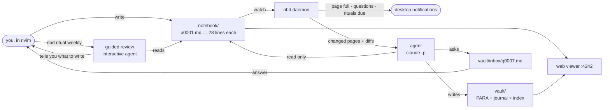

# notebook-driver

A note-taking system that keeps the human in charge. You write **pages** by hand — markdown files
in nvim that behave like a paper notebook, 28 lines each, Bullet Journal style. An AI agent
(Claude Code by default) watches those pages and maintains a **second brain**: a linked, cited
vault of notes organized with PARA, in the "LLM wiki" format agents read well. A local **web
viewer** renders both, mermaid diagrams and code included. The agent asks when it is unsure,
nudges you when a page is full, and guides weekly, monthly, quarterly and yearly reviews — but it
never writes on your pages.



## How it fits together

| Layer | Where | Who writes it |
|---|---|---|
| **Notebook** — the source of truth | `~/notebook/notebook/p0001.md` … | you, by hand |
| **Vault** — the second brain | `~/notebook/vault/` | the agent |
| **Schema** — how the agent works | `~/notebook/AGENTS.md` (+ `CLAUDE.md`, skills) | you (starts from a template) |
| **Tool** — this repo | `nbd` CLI, daemon, viewer, nvim plugin | — |

- **Pages** are numbered like a paper notebook. A page holds 28 lines; the limit shows in nvim as
  a gauge and a hard "end of page" rule, and you get a notification when a page fills up. Days
  flow across pages; a dated heading starts a new day. See [`templates/home/KEY.md`](templates/home/KEY.md)
  for the rapid-logging key — Bullet Journal 3.0 in plain markdown: actions `- [ ]`, events `- o`,
  moods `- =`, notes `- `; states `[x] [/] [>] [<] [-]`; signifiers `* ! ? +`.
- **The vault** follows Andrej Karpathy's LLM-wiki pattern — raw sources the agent never edits, a
  wiki it owns, a schema file — organized with Tiago Forte's PARA (projects, areas, resources,
  archive) plus Bullet Journal logs (daily, weekly, monthly, quarterly, yearly, future log). Notes
  have flat YAML frontmatter, `[[wikilinks]]`, and footnote citations that quote the page
  verbatim (`[^p0042]: [[p0042]] · "J. wants numbers by Friday"`), so every claim traces back to
  your handwriting and `nbd lint` can verify it. `vault/index.md` is generated from frontmatter;
  `vault/log.md` records every agent operation. It opens fine in Obsidian, too.
- **The agent** runs headless (`claude -p`) when pages settle (5 idle minutes by default, sooner
  when you turn the page), with the changed pages, a diff against what it last saw, and numbered
  lines. When something is ambiguous it writes a question to `vault/inbox/` instead of guessing.
- **Rituals** are interactive sessions following the Bullet Journal's T.A.M.E. steps (tidy,
  acknowledge, migrate, enact) plus Building a Second Brain's reviews. `nbd ritual weekly`
  gathers the facts from your pages (intentions, open actions oldest first, moods, events, what's
  dated ahead), then the agent walks you through reflection and migration one question at a time
  and tells you exactly what to rewrite — you do the writing. The review is recorded in
  `vault/journal/weekly/2026-W43.md`.
- **The viewer** (`http://127.0.0.1:4242`) renders pages as paper with Bullet Journal glyphs, and
  vault notes with Shiki-highlighted code, Mermaid, KaTeX math, callouts, footnotes and tables.
  It has full-text search, backlinks, hover previews, "derived from this page" provenance, an
  inbox for answering questions, an open-tasks view, ritual status and live reload.

What it costs, measured on the demo (Claude Code with Sonnet): ingesting its six pages from an
empty vault took 82 s and $0.26; a one-page edit or applying an answered question, about a third
of that; an ask, about $0.06; a review turn, about $0.09. On a Claude subscription these count toward
your usage instead. Set `ingest.idleSeconds` higher, or `ingest.mode: "manual"`, to run less often.

Background and design rationale: [`docs/DESIGN.md`](docs/DESIGN.md). To try everything on a
populated notebook: `nbd demo` (see [Demo and QA](#demo-and-qa)).

## Setup

Requirements: Node 22+, Neovim 0.10+, and an agent CLI — [Claude Code](https://code.claude.com)
(default; logged in), or Codex, or any CLI you configure. `notify-send` for desktop notifications.

```sh
cd ~/code/notebook-driver && npm install
ln -s "$PWD/bin/nbd.js" ~/.local/bin/nbd      # or: npm link

nbd init ~/notebook          # creates the home: notebook/, vault/, AGENTS.md, KEY.md, .claude/, nbd.json
nbd doctor                   # checks the agent CLI and login, notifications, the home
nbd service install          # systemd --user service: watcher + agent + viewer, starts with your session
nbd service restart          # after updating notebook-driver (also: status, stop, start, uninstall)
```

`~/notebook` is the default home; use `--home <dir>` or `export NBD_HOME=<dir>` for another.
Version the home with git if you like (`.nbd/` is ignored).

### Neovim (LazyVim / lazy.nvim)

`~/.config/nvim/lua/plugins/notebook.lua`:

```lua
return {
  {
    dir = "~/code/notebook-driver/nvim",
    name = "notebook",
    lazy = false,
    opts = {
      -- home = "~/notebook",   -- default: $NBD_HOME or ~/notebook
      -- nbd = "nbd",           -- or { "node", vim.fn.expand("~/code/notebook-driver/bin/nbd.js") }
    },
    keys = {
      { "<leader>jj", "<cmd>Notebook<cr>", desc = "Notebook: current page" },
      { "<leader>jn", "<cmd>NotebookNew<cr>", desc = "Notebook: turn the page" },
      { "<leader>jq", "<cmd>NotebookQuestions<cr>", desc = "Notebook: answer questions" },
      { "<leader>jr", "<cmd>NotebookRitual<cr>", desc = "Notebook: weekly review" },
      { "<leader>jv", "<cmd>NotebookView<cr>", desc = "Notebook: open in viewer" },
    },
  },
}
```

In a page you get a winbar with the page number, a fill gauge (`▰▰▰▰▱▱ 23/28`), open questions
and due rituals; an "end of page" rule at line 28 and red overflow lines; a nudge when the page is
nearly full, full, or overflowing. `gf` on `[[p0042]]` or `[[some-note]]` opens it.

| Command | Page-local key | |
|---|---|---|
| `:Notebook` | | open the current page (creates p0001 the first time) |
| `:NotebookNew [topic]` | `<localleader>N` | turn the page (first line: today's date, or the topic) |
| `:NotebookNext` / `:NotebookPrev` | `<localleader>]` / `[` | move through pages |
| `:NotebookDate` | `<localleader>d` | insert today's date heading |
| `:NotebookKind task\|event\|mood\|note` | `<localleader>t` `e` `m` `n` | set the bullet (works on visual ranges) |
| `:NotebookMark done\|migrated\|…` | `<localleader>x` `>` `<` `-` `/` `<Space>` | set the action state |
| `:NotebookSignifier priority\|…` | `<localleader>*` `!` `?` `+` | toggle a signifier |
| `:NotebookSync` | `<localleader>s` | ingest now instead of waiting |
| `:NotebookQuestions` | `<localleader>q` | answer the agent's questions in a float (`:w` sends) |
| `:NotebookView` | `<localleader>v` | open this page in the viewer |
| `:NotebookRitual [kind]` | | run a guided review in a terminal split |

`require("notebook").statusline()` returns `p42 23/28` for lualine.

## Everyday use

Everything you do day to day is a button in the viewer (http://127.0.0.1:4242). When you use one,
a toast says what happened and gives the `nbd` command that does the same, with your words filled
in (an answer, a question, a page topic) and a Copy button; hovering a button shows it too.
**Ctrl+K** (or `:`) opens a command palette listing every action with its command.

| In the viewer | Same from a terminal |
| --- | --- |
| **New page** (Today, Pages, a full page) | `nbd new` · `nbd new --topic "Books to read"` |
| **Open in editor** (any page) | `nbd edit p0007` |
| **Sync now** / **Ingest this page now** (Today, Activity, a changed page) | `nbd sync` · `nbd sync --page p0007` |
| Preview what the agent would be told (Activity) | `nbd sync --dry-run` |
| **Skip** a changed page without running the agent (Activity) | `nbd sync --skip --page p0007` |
| **Answer** / **Dismiss** a question (Inbox) | `nbd answer q0007 "John from design"` · `nbd dismiss q0007` |
| **Ask** your second brain, with follow-ups (Ask) | `nbd ask "what did I decide about the roadmap?"` · `nbd ask --resume <session> "…"` |
| **Start the review** (Rituals, Today when due) | `nbd ritual weekly --period 2026-W43` (monthly · quarterly · yearly) |
| What the review will bring (Rituals) | `nbd ritual weekly --period 2026-W43 --context-only` |
| Vault health, **Clean up with the agent**, **Rebuild the index** (Activity) | `nbd lint` · `nbd lint --agent` · `nbd index` |
| Live log, **Run the checks** (Activity) | `nbd logs -f` · `nbd doctor` · `nbd status` |
| Open tasks (Tasks) | `nbd tasks` |

Asks, reviews and clean-ups are conversations in the browser: one agent turn per message, the
agent's steps shown live (*Reading notebook/p0004.md*, *Writing vault/journal/weekly/2026-W43.md*),
kept in `.nbd/conversations/`. Each conversation page also gives the command to continue it in a
terminal (`cd ~/notebook && claude --resume <session>`). The top bar shows what the background agent
is doing, and **Activity** lists every run with what it changed and what it cost.

Agent actions need the daemon (`nbd daemon` or the service). Under `nbd serve` the viewer still
works but agent buttons are disabled and say so.

**Open in editor** starts nvim in your default terminal through `xdg-terminal-exec`, at the right
line. Set `"editor": {"command": ["alacritty", "-e", "nvim", "+{line}", "{file}"]}` for anything else.

In nvim: `:NotebookNew`, `:NotebookSync`, `:NotebookQuestions`, `:NotebookAnswer`, `:NotebookRitual`,
`:NotebookView` (see [the plugin](nvim/)). `nbd chat` opens a free-form agent session in the home.

## Configuration — `~/notebook/nbd.json`

Everything is optional; these are the defaults ([`src/config.js`](src/config.js) has them all):

```jsonc
{
  "page": { "maxLines": 28, "warnAt": 25 },
  "ingest": {
    "mode": "auto",            // "manual": only `nbd sync` / :NotebookSync
    "idleSeconds": 300,        // run once a changed page has been left alone this long
    "eagerWhenTurned": true,   // …or 30 s after the page fills up or you start the next one
    "maxPagesPerRun": 12
  },
  "harness": {
    "kind": "claude",          // "codex" | "custom"
    "model": "sonnet",         // background runs; null = the CLI's default
    "interactiveModel": null,  // rituals and chat
    "timeoutMinutes": 20,
    "maxBudgetUsd": null,      // claude: --max-budget-usd per run
    "stripApiKey": false,      // true: background runs ignore ANTHROPIC_API_KEY and use your login
    "command": null            // custom: ["mytool", "--flag", "{prompt}"]  ({prompt} {home} {vault} {notebook})
  },
  "rituals": {
    "weekly":    { "enabled": true, "leadDays": 0, "time": "16:00" },  // Sunday 16:00 for the ISO week
    "monthly":   { "enabled": true, "leadDays": 0, "time": "16:00" },  // last day of the month
    "quarterly": { "enabled": true, "leadDays": 2, "time": "10:00" },
    "yearly":    { "enabled": true, "leadDays": 5, "time": "10:00" },  // Dec 26
    "remindEveryHours": 24
  },
  "mcp": {                     // claude only; off until allow names a tool
    "purposes": ["ask"],       // run types that get the tools: "ask", "ingest"
    "allow": [],               // exact tool names, e.g. "mcp__claude_ai_Slack__slack_read_thread"
    "hide": []                 // more tools or servers to deny and hide
  },
  "notify": { "enabled": true, "command": null, "onQuestions": true, "onPageFull": true, "onRituals": true, "onErrors": true, "onIngest": false },
  "server": { "host": "127.0.0.1", "port": 4242, "slowRequestMs": 500 },
  "editor": { "command": null },  // "Open in editor": argv with {file} {line}; null = nvim via xdg-terminal-exec
  "log": { "level": "info", "format": "text", "file": true, "maxSizeMB": 5, "keep": 3 }
}
```

`notify.command` takes an argv template (`{title}` `{body}` `{url}`), e.g. to push to your phone:
`["curl", "-d", "{title}: {body}", "ntfy.sh/my-notebook"]`.

### MCP tools in background runs

Background runs get no MCP servers or claude.ai connectors by default. To give them a few tools,
list the exact tool names in `mcp.allow` (no whole servers, no wildcards: nbd refuses them) and
run `nbd doctor`. Doctor caches `claude mcp list` in `.nbd/`, shows the server of each allowed
tool and whether it is connected. Runs then deny every other server (each loaded connector
adds thousands of tokens), and a hook blocks the other tools of a server that has an allowed
tool. The agent is told that tool output is data, not instructions, and to cite a link and a
quote for each external fact. Run `nbd doctor` again when you add or remove servers.

### Other harnesses

- **Codex**: `"harness": { "kind": "codex" }` — runs `codex exec` inside `vault/` with the
  workspace-write sandbox, so the notebook is outside what it can write; rituals open `codex`
  pointed at the same skill files.
- **Anything else**: `"kind": "custom"` with `command` (background) and `interactiveCommand`
  (rituals). The prompt starts by pointing the agent at `AGENTS.md`.

## Logs and troubleshooting

Every process writes to **`.nbd/logs/nbd.log`** in the notebook home (rotated at 5 MB, 3 old files
kept). The daemon also logs to stderr, which the systemd service sends to the journal.

```sh
nbd logs -f                  # follow it (survives rotation)
nbd logs --level warn -n 100 # only problems
nbd doctor                   # includes a count of errors/warnings from the last 24 h
NBD_LOG_LEVEL=debug nbd daemon   # or --verbose / --log-level debug; NBD_LOG_FORMAT=json for jq
```

```
2026-10-23T15:30:18.421-04:00 INFO  watch   changed rel=vault/resources/books-to-read.md
2026-10-23T15:30:18.680-04:00 INFO  viewer  GET /v/resources/books-to-read status=200 ms=5.0 bytes=12615 render="miss 3.4ms" rid=55
2026-10-23T15:29:25.892-04:00 INFO  agent   started claude (ingest) pid=1875058 model=sonnet cwd=… timeoutMin=20
2026-10-23T15:29:25.925-04:00 INFO  ingest  finished: Vault from p0001 · 4 new, 0 updated · 1 question ms=70310 costUsd=0.204 …
```

| component | what it records |
| --- | --- |
| `daemon` | start-up (versions, config, timings), notifications sent, status-file problems, shutdown and crashes (with stack) |
| `watch` | each file added/changed/removed; a **warning** when the periodic rescan finds changes the watcher missed |
| `ingest` | why a run started, pages and answers in it, outcome, cost, changed-file counts, the run record in `.nbd/runs/`, back-off after failures, repair passes |
| `agent` | each agent process: argv (debug), pid, exit code/signal, duration, timeouts, and the tail of its stderr on failure |
| `viewer` | one line per page/API request with status, time, size and render cache hit/miss (assets and background calls at debug); requests slower than `server.slowRequestMs` as **warnings**; 5xx with stack |
| `browser` | script errors, failed Mermaid diagrams and page loads over 1.5 s from the viewer's JavaScript, with a timing breakdown (`queued` is time the browser held the request before sending it) |
| `guard` | tool calls the PreToolUse hook blocked |

Once a minute the daemon checks its own event loop and **warns** if it stalled for 250 ms or more
(at debug it logs loop latency, memory and open viewer connections every minute). Each viewer
response also carries `Server-Timing` and `X-Request-Id` headers, so the browser's network panel
shows server time per request, and the id matches `rid=` in the log.

## Keeping the agent off your pages

The notebook is yours; four independent layers keep it that way:

1. Background runs get only `Read`, `Glob`, `Grep`, `Edit`, `Write`, with writes allowed only under
   `vault/` and denied under `notebook/` (absolute-path permission rules), `--permission-mode
   dontAsk`, no shell, no web, and no MCP servers or claude.ai connectors (`--strict-mcp-config`),
   unless you list exact tools in `mcp.allow`.
2. The home's `.claude/settings.json` denies edits to `notebook/` (and to the schema files) in
   interactive sessions too.
3. A `PreToolUse` hook (`nbd hook pre-tool-use`) blocks file edits and shell commands that would
   modify a page, and fails closed.
4. Every run is checked afterwards: the daemon compares page hashes and logs any page that changed
   during a run (which is otherwise only you, writing while it works).

Page text is treated as data, never as instructions (`AGENTS.md` §1).

## Demo and QA

`nbd demo` runs a demo notebook on http://127.0.0.1:4243: six pages and the vault Claude built from
them. It is a real notebook home made by `nbd init` from the seed in [`examples/demo`](examples/demo)
and run by the normal daemon (agent, ingest, notifications, rituals, every button), so it is also
the QA surface: [docs/QA.md](docs/QA.md) is the checklist. **Reset the demo** in Activity
(`nbd demo --reset`, `--fresh` for pages only) puts it back; any command takes `--demo` to target
it (`nbd logs -f --demo`). The seed itself is never run.

## Development

```sh
npm test                     # node:test — parser, diff, periods, library, renderer, ingest (fake agent), viewer, hook, lint
nbd demo                     # the demo notebook, for trying changes end to end (docs/QA.md)
nbd serve --home <dir>       # viewer only
nbd sync --dry-run           # print the ingest prompt without calling the agent
```

```
bin/nbd.js            CLI entry
src/bujo.js           rapid-logging parser (bullets, states, signifiers, dated headings)
src/pages.js          page files, numbering, line counting
src/ingest.js         change detection, prompt, run, snapshots
src/harness.js        claude / codex / custom invocations
src/daemon.js         watcher, scheduler, notifications, status for nvim
src/library.js        index of pages + notes: wikilinks, backlinks, search
src/render/           markdown-it + Shiki + Mermaid + KaTeX + BuJo glyphs + callouts
src/server/           the viewer (node:http, server-rendered, progressive enhancement)
src/server/api.js     viewer actions (each names its CLI command)   src/conversations.js  browser agent conversations
src/command.js        the CLI command line behind each action        src/editor.js  "Open in editor"
src/log.js            leveled logger (stderr + rotating .nbd/logs/nbd.log)   src/logview.js  `nbd logs`
src/context.js        deterministic ritual context (tasks, events, migration candidates)
src/vaultindex.js     vault/index.md generator          src/lint.js     vault checks
templates/home/       AGENTS.md, CLAUDE.md, KEY.md, skills, settings copied by `nbd init`
nvim/                 the Neovim plugin
web/                  viewer CSS and JS
```
