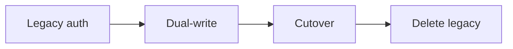

# 2026-10-22 Thu
- o Q4 planning offsite
  - three bets: auth migration, billing v2, mobile perf
  - Priya owns billing v2; I own auth migration
- = energized, a bit anxious about the cutover
- [ ] write auth migration design doc
- ! "bets not plans": state the bet, the signal, the stop condition
- plumber coming Fri 10:00
- + why do cutovers always slip

- [ ] * register for the half marathon before the 29th
