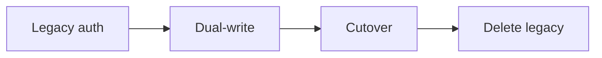

# 2026-10-22 Thu

At the Q4 planning offsite the team chose three bets, and you own the auth migration. You also have a half marathon registration to do before the 29th.

## Summary
Offsite settled [[q4-roadmap]] bets; [[auth-migration]] is yours, [[priya]] owns billing v2.

## Tasks
- [ ] write auth migration design doc ([[p0004]])[^p0004-2] — [[auth-migration]]
- [ ] * register for the half marathon before the 29th ([[p0004]])[^p0004-3] — [[half-marathon]]

## Events
- Q4 planning offsite: three bets: auth migration, billing v2, mobile perf. [[priya]] owns billing v2; you own auth migration.[^p0004][^p0004-1b]

## Moods
- energized, a bit anxious about the cutover[^p0004-4]

## Notes
- Inspiration: "bets not plans": state the bet, the signal, the stop condition.[^p0004-5]
- Plumber coming Fri 10:00.[^p0004-6]
- To expand: why do cutovers always slip.[^p0004-7]
- Your diagram of the migration plan:

- Books list started on [[p0005]]: see [[books-to-read]].

## Mentioned
[[priya]], [[auth-migration]], [[q4-roadmap]], [[half-marathon]], [[books-to-read]]

[^p0004]: [[p0004]] · "three bets: auth migration, billing v2, mobile perf"
[^p0004-1b]: [[p0004]] · "Priya owns billing v2; I own auth migration"
[^p0004-2]: [[p0004]] · "write auth migration design doc"
[^p0004-3]: [[p0004]] · "register for the half marathon before the 29th"
[^p0004-4]: [[p0004]] · "energized, a bit anxious about the cutover"
[^p0004-5]: [[p0004]] · ""bets not plans": state the bet, the signal, the stop condition"
[^p0004-6]: [[p0004]] · "plumber coming Fri 10:00"
[^p0004-7]: [[p0004]] · "why do cutovers always slip"
